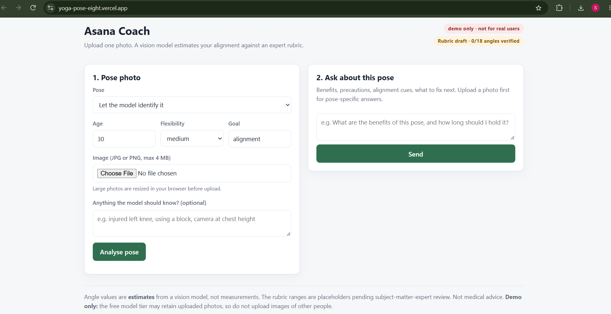
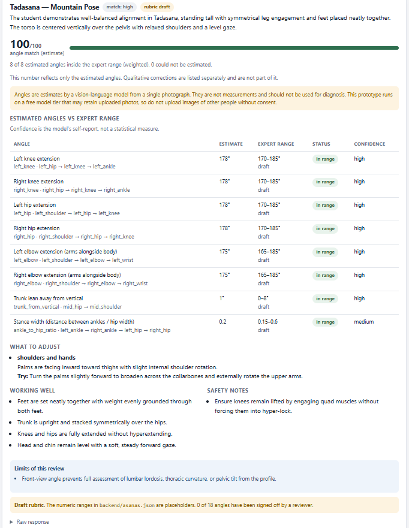
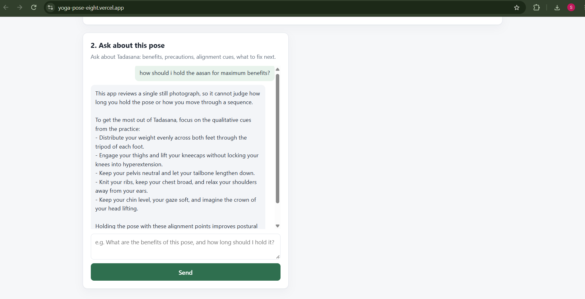

# Asana Coach — Samartha Hackathon Prototype

**Live demo:** https://yoga-pose-eight.vercel.app/\
**Project:** Samartha — 36-hour hackathon conducted by MBU\
**Status:** Prototype for demonstration and implementation planning only

> **Important — not for real-user use.** This project is an
> experimental prototype. Its angle ranges are placeholders and have not
> been validated or approved by a qualified yoga subject-matter expert
> (SME). It also uses a free-tier vision-language model (VLM) provider
> whose data-handling terms may allow submitted images to be retained or
> used to improve its services. Do not upload private, sensitive, or
> non-consensual photos.

## 1. Overview

Asana Coach is a single-page prototype that lets a user upload one photo
of a yoga pose. A vision-language model powered by Gemini produces an
estimated alignment review against a configurable rubric, including:

-   Pose identification for supported poses.
-   Estimated joint angles and comparisons with rubric ranges.
-   An estimated angle-match score.
-   Suggested corrections, positive observations, safety notes, and
    caveats.
-   Follow-up answers grounded in the selected asana's rubric and the
    latest analysis.

The application currently supports:

-   **Tadasana** — Mountain Pose
-   **Virabhadrasana II** — Warrior II

The app is stateless: it has no user accounts, database, or analysis
history. The browser sends the latest analysis with each follow-up
question.

## 2. Hackathon context and intended use

This project was built as a prototype during **Samartha, a 36-hour
hackathon conducted by MBU**. Its purpose is to demonstrate a possible
implementation and make the requirements for a more reliable system
concrete.

The current application is **not a validated yoga assessment product**
and must not be represented as one. A successful demo or technically
correct API response does not establish that the angle estimates,
rubric, score, or coaching suggestions are accurate.

The next major step is subject-matter-expert review: the actual
instructions, pose variations, angle definitions, accepted ranges, and
qualitative cues must be populated or approved by qualified yoga
experts. Evaluation against labelled examples is also required before
real-world use can be considered.

## 3. Current limitations and safety

### Expert rubric is still a draft

The rubric lives in `backend/asanas.json`. It contains two asanas and 18
angle criteria, but **0 of 18 angles have been verified by an SME**. The
numeric ranges are provisional placeholders, not expert-approved
standards.

The model estimates angles from a single 2D photograph. These values are
not precise biomechanical measurements. A front-facing image cannot
reliably establish every aspect of alignment, balance, weight
distribution, or joint position. The model may also vary its feedback
between repeated runs.

The application labels the score as an **angle-match estimate**. The
score reflects only estimated angles that fall within the configured
ranges; qualitative corrections are displayed separately and are not
included in that number.

### Not for real users: image privacy

The prototype uses a **free-tier VLM API**. Under the provider's
applicable free-tier terms, submitted content may be retained or used to
improve the provider's services. Images are processed by the application
and sent to the model provider; not storing images in our own database
does **not** prevent provider-side retention.

For this reason, the deployed demo is for controlled demonstration and
testing only. Use only stock images or images of consenting adults that
are appropriate to share with the provider. Do not upload images of
children, private or sensitive situations, or anyone who has not
consented.

Before any real-world release, the project needs a privacy and security
review, suitable provider/data-processing terms, clear informed consent,
a privacy notice and retention/deletion policy, and appropriate abuse
protection. The model provider's current terms must be checked at that
time; this README is not a legal assessment.

### Other current limits

-   Only Tadasana and Virabhadrasana II are supported.
-   No dedicated pose-estimation model is used; the VLM estimates the
    angles.
-   No video analysis, rep counting, hold-time measurement, or flow
    tracking.
-   No authentication, accounts, persistence, history, or rate limiting.
-   No validated accuracy evaluation set yet.
-   No medical, diagnostic, therapeutic, or injury-prevention claims.
-   Vercel deployment must be tested in the live environment whenever
    the deployment configuration or backend changes.

## 4. How it works

### Analysis flow

1.  The browser loads the rubric and supported asanas.
2.  The user chooses a pose (or automatic identification), optionally
    supplies profile details and notes, and selects a JPG or PNG.
3.  The browser resizes large images before upload.
4.  The FastAPI backend validates and normalizes the image, then sends
    the photo and rubric context to Gemini.
5.  The backend parses and normalizes the model response.
6.  The server recomputes each angle's in-range result from the rubric
    rather than trusting the model's score or pass/fail claims.
7.  The UI displays the estimated results, corrections, caveats,
    model/fallback details, and draft-rubric warnings.
8.  Follow-up questions are sent with the latest analysis so the chat
    can answer without server-side session storage.

### Main technologies

-   Python and FastAPI
-   Gemini through an OpenAI-compatible API endpoint
-   Vanilla HTML, CSS, and JavaScript
-   Pillow for image processing
-   Vercel deployment configuration
-   Docker Compose for local containerized development

## 5. API overview

| Method | Endpoint | Purpose |
| --- | --- | --- |
| `GET` | `/api/health` | Health and configuration metadata |
| `GET` | `/api/asanas` | Supported poses, rubric metadata, and validation issues |
| `GET` | `/api/asanas/{id}` | Full rubric entry for one pose |
| `POST` | `/api/analyze` | Analyze an uploaded pose photograph |
| `POST` | `/api/chat` | Ask a follow-up question about the pose and latest analysis |
| `GET` | `/docs` | FastAPI interactive API documentation |

## 6. Run locally

### Requirements

-   Python version compatible with `.python-version`
-   A Gemini API key
-   Dependencies from `requirements.txt`

### Setup

1.  Clone the repository:

    ``` bash
    git clone https://github.com/Sivasindhuja/Samartha-YogaDristhti.git
    cd Samartha-YogaDristhti
    ```

2.  Create and activate a virtual environment:

    ``` bash
    python -m venv .venv
    ```

    Windows PowerShell:

    ``` powershell
    .venv\Scripts\Activate.ps1
    ```

    macOS/Linux:

    ``` bash
    source .venv/bin/activate
    ```

3.  Install dependencies:

    ``` bash
    pip install -r requirements.txt
    ```

4.  Create a local `.env` file in the repository root and add your API
    key. Do not commit this file:

    ``` dotenv
    GEMINI_API_KEY=your_api_key_here
    GEMINI_MODEL=gemini-3.6-flash
    ```

    The configured fallback model is `gemini-3.5-flash-lite`. Model
    availability and quotas depend on the API project and provider
    terms. Never expose an API key in frontend code or commit it to Git.

5.  Start the backend:

    ``` bash
    cd backend
    uvicorn main:app --reload --port 8000
    ```

6.  Open `http://localhost:8000`. Check the API at
    `http://localhost:8000/api/health` and documentation at
    `http://localhost:8000/docs`.

For Docker-based development, see `docker-compose.yml` and the backend
Docker configuration.

## 7. Subject-matter-expert review and path to real-world use

The most important unfinished work is **not adding more features**; it
is making the rubric and resulting feedback trustworthy.

Recommended sequence:

1.  **Define each pose variation.** Specify foot placement, arm
    position, camera view, and allowed modifications for each supported
    asana.
2.  **Review all 18 angle criteria.** A qualified yoga SME should review
    the landmark definitions, angle meaning, proposed range, tolerance,
    weighting, and limitations for each criterion.
3.  **Replace placeholder instructions.** Add reviewed alignment cues,
    common mistakes, modifications, benefits, and precautions, with
    appropriate references where possible.
4.  **Resolve rubric conflicts.** For example, decide how knee extension
    ranges relate to advice not to lock the knees, and how stance width
    should be defined for each Tadasana variation.
5.  **Record approval.** Mark a criterion verified only after review;
    update the rubric status and reviewer documentation consistently.
6.  **Build an evaluation set.** Gather approximately 30–50
    appropriately consented and labelled photographs across correct
    poses, common errors, body types, camera angles, lighting
    conditions, and unsupported poses.
7.  **Measure performance.** Compare estimates and feedback with the
    reference labels, document errors and uncertainty, and test
    repeatability. Do not treat the model's self-reported confidence as
    a statistical confidence score.
8.  **Complete privacy and security work.** Review provider data
    handling, use an appropriate API/data-processing arrangement, add
    consent and privacy notices, define retention/deletion practices,
    protect API credentials, and add abuse controls as appropriate.
9.  **Re-test deployment.** Run live smoke tests and verify failure
    handling, quotas, latency, request limits, and logs before any
    broader release.

Until these steps are completed and the results support the intended
use, keep the application labelled as a prototype and do not use it to
guide high-stakes health, rehabilitation, or injury-related decisions.

## 8. Screenshots

All screenshots below are committed in `docs/screenshots/`.

### Home and upload form



### Tadasana analysis



### Follow-up chat



A Virabhadrasana II screenshot can be added later as
`docs/screenshots/analysis-warrior-ii.png` and embedded the same way.

Only add screenshots that are actually present in the repository. Avoid
screenshots containing API keys, private information, or photographs
uploaded without consent.

## 9. Project status and handoff

See **[`STATUS.md`](STATUS.md)** for the detailed development handoff,
including:

-   Current implementation and files
-   What has been tested and what has not
-   The two main blockers: unverified rubric and privacy/security
    concerns
-   Known defects and risks
-   Decisions already made
-   Work deliberately out of scope
-   Recommended order for resuming development

The status document should be kept up to date as implementation and
validation progress. A deployment URL alone should not be taken as
evidence that the project is ready for real users.

## 10. Links

-   **Live prototype:** https://yoga-pose-eight.vercel.app/
-   **GitHub repository:**
    https://github.com/Sivasindhuja/Samartha-YogaDristhti
-   **Detailed status and handoff:** [`STATUS.md`](STATUS.md)

------------------------------------------------------------------------

**Disclaimer:** Asana Coach is a hackathon prototype for demonstration
and implementation planning. Its angle estimates and draft rubric are
not expert-verified measurements or medical advice.
